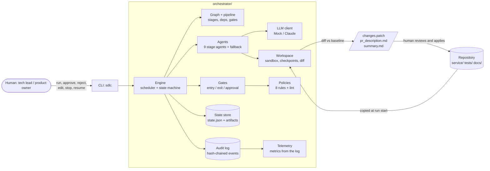
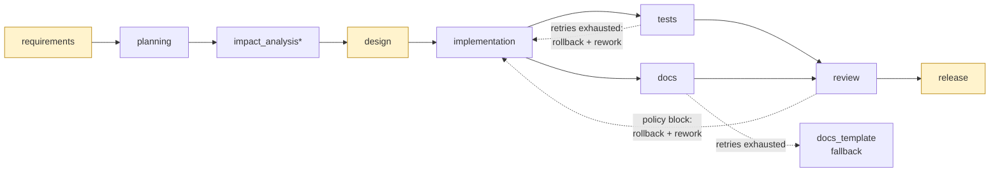
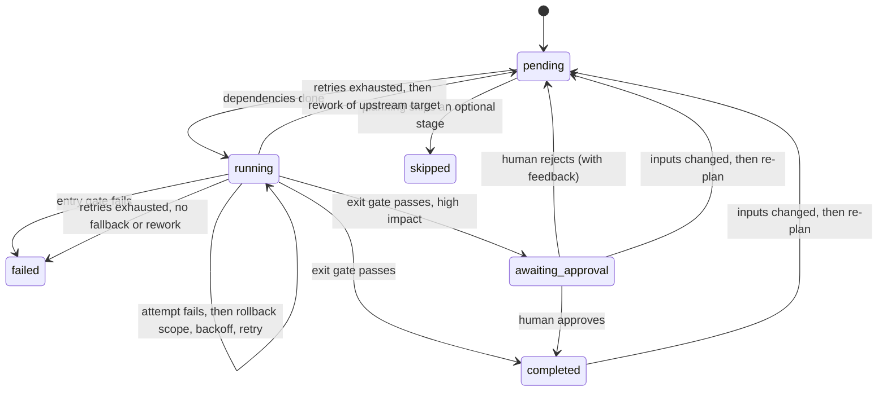

# Architecture overview

The system has two parts that live in one repository:

| Part | Package | Role |
| --- | --- | --- |
| URL shortener | `service/` | The product: a FastAPI service with create, redirect, analytics and reliability features |
| Agentic SDLC orchestrator | `orchestrator/` | The engine that turns a requirement into a reviewed, tested, policy-checked change to the service |

The orchestrator is the focus of the assessment. The service is its workload: every scenario
is a real change to `service/`, produced by agents, validated by gates and policies, and
signed off by humans.

## 1. Components

| Component | File | Responsibility |
| --- | --- | --- |
| Engine | `engine.py` | Schedules ready stages, runs agents, applies gates, handles retries, fallback, rework, rollback, approvals, safe-stop and re-planning; persists state after every transition |
| Graph | `graph.py` | Typed `Stage` definitions; validates the DAG (unknown dependencies, cycles, rework targets must be upstream); computes order, levels, ancestors, descendants |
| Pipeline | `pipeline.py` | The default nine-stage SDLC graph with its gates, approval rules and recovery rules |
| Agents | `agents/` | One class per stage with a single method `run(ctx) -> StageResult`; they read artifacts and the workspace, never run state |
| LLM | `llm.py` | `MockLLM` replays scripted JSON per stage and call number; `ClaudeLLM` calls the Anthropic API; both return JSON that agents validate |
| Gates | `gates.py` | Pure functions over a stage's outputs: entry gates (inputs present), exit gates (output acceptable), approval rules (needs sign-off?) |
| Policies | `policies.py` | Security, compliance and change-control rules over the change set, with severities `block`, `approval`, `warn` |
| Workspace | `workspace.py` | Per-run sandbox: baseline copy, working copy, scoped edits, checkpoints, rollback, subprocess tools, git-applicable diff |
| State store | `state.py` | Atomic `state.json`; versioned, content-hashed artifacts; decisions; approvals; safe-stop flag |
| Audit log | `events.py` | Append-only JSONL; each event carries the previous event's hash; `verify_chain` detects edits, deletions, reordering |
| Telemetry | `telemetry.py` | Reliability metrics computed only from the audit log |
| Reporting / CLI | `reporting.py`, `cli.py` | Status, lineage trace, engineering summary; the `sdlc` command humans use |

## 2. Orchestration model

### The pipeline (an explicit dependency graph)

`*` optional: planning may skip it (greenfield). Highlighted stages have human approval
checkpoints. Run `sdlc graph` to print the same structure.

| Stage | Reads | Writes (workspace) | Exit gate | Approval | Recovery |
| --- | --- | --- | --- | --- | --- |
| requirements | request | - | spec has title, testable criteria, every ambiguity has a default | if ambiguities exist | retry |
| planning | spec | - | tasks exist, dependencies known, no cycles | - | retry |
| impact_analysis | spec, plan | - | names affected modules; all exist (unless new) | - | retry; optional |
| design | spec, plan, impact | - | summary, components, ADR; API/schema change stated as true/false | if API contract or schema changes | retry |
| implementation | spec, design | `service/` | files changed, all compile, contract regenerated | - | retry |
| tests | spec, implementation | `tests/` | new tests exist and the full suite passes | - | retry, then rework implementation |
| docs | spec, design | `docs/` | documentation written | - | retry, then fallback agent |
| review | design, impl, tests, docs | - | no blocking policy finding, lint clean | - | rework implementation |
| release | policy report, test report | - | non-empty patch | always | - |

### Parallel paths and synchronisation

Every pass, the engine starts **all** pending stages whose dependencies are done, with
`asyncio.gather`. `tests` and `docs` both depend only on `implementation`, so they run
concurrently (logged as `parallel_batch`). `review` depends on both, so it is a join: it starts
only when both have completed. Stages write to disjoint workspace scopes (`tests/` vs `docs/`),
so a rollback of one never touches the other.

### Stage lifecycle

Run states: `created -> running -> paused (waiting for a human) | stopped (safe-stop) |
completed | failed`. A paused or stopped run resumes from disk in any later process.

## 3. Control flow

### Main loop (`Orchestrator.run_async`)

1. If a stop is requested, persist and return `stopped`.
2. Re-plan check: any completed stage whose input artifact hashes changed since it ran is reset,
   with all of its descendants; their workspace scopes are rolled back.
3. Find ready stages (pending, all dependencies `completed` or `skipped`). If none: finish as
   `completed`, `paused` (approvals outstanding) or `failed`.
4. Checkpoint the workspace (`cpNNN`), record it on each ready stage, run them concurrently.
5. Apply any rework outcomes, persist, go to 1.

### One stage (`Orchestrator._execute`)

1. Entry gate. Failure here means bad inputs: the stage fails without retrying.
2. Up to `max_attempts`: run the agent in a thread with a timeout, then the exit gate.
   A failed attempt restores the stage's write scope from its checkpoint, adds the gate's
   reasons to the agent's feedback, waits with exponential backoff, and tries again.
3. Exhausted: run the fallback agent if defined; else return `rework` if the stage has a rework
   target (bounded by `max_reworks` per run); else the stage fails.
4. Accept: store output artifacts (versioned, hashed), record input hashes and decisions with
   their parents, apply planning's skips, then `awaiting_approval` or `completed`.

### Recovery paths at a glance

| Trigger | Response | Bound | Logged as |
| --- | --- | --- | --- |
| Agent error, invalid JSON, timeout, exit gate fails | Roll back the stage's scope, retry with the reasons as feedback | `max_attempts` (3), backoff 0.5 s doubling | `attempt_failed`, `rollback`, `retry_scheduled` |
| Edit outside allowed paths | Refused before any write; treated as a failed attempt | same | `policy_violation` |
| Retries exhausted, fallback defined | Deterministic fallback agent | once | `fallback_started` |
| Tests or review fail after retries | Roll back to the implementation checkpoint, redo implementation and everything downstream with the failure as feedback | `max_reworks` (2) per run | `rework`, `rollback` |
| Rework budget spent | Stage fails, nothing is released | - | `rework_limit_reached`, `run_failed` |
| Human rejects an output | Roll back, redo that stage with the reviewer's comment | - | `approval_rejected` |
| Upstream artifact changes | Reset stale stages and descendants, roll back their scopes | - | `replan` |
| Operator safe-stop | Finish in-flight stages, persist, halt; `resume` continues | - | `safe_stop_requested`, `run_stopped` |

## 4. Context, lineage and audit

- **Artifacts** (`spec`, `plan`, `impact`, `design`, `implementation`, `test_report`, `docs`,
  `policy_report`, `release`) are stored as versioned JSON files and never overwritten. Each
  version records its content hash and producer (an agent or `human:<name>`).
- **Cross-stage context**: agents read upstream artifacts through `ctx.artifact(name)`; the
  workspace carries code changes forward; feedback from failed gates and reviewers is passed
  into the next attempt's prompt.
- **Decision lineage**: every decision records the artifact hashes it was based on and the
  decisions it builds on. `sdlc trace` prints the chain from requirement to release, including
  human approvals and edits.
- **Audit log**: every transition is an event with timestamp, actor (agent, engine,
  `human:<name>`, or `auto-approve`), stage and data, chained by SHA-256. `sdlc verify` checks
  the chain; the test suite proves tampering is detected.

## 5. Controlled autonomy

| Agents may | Agents may not | Humans decide |
| --- | --- | --- |
| Propose specs, plans, designs | Write outside their stage's allowed paths | Sign off ambiguous specs |
| Edit code, tests, docs in the sandbox | Touch `.github/`, `orchestrator/`, `scenarios/`, `.env` | Approve API/schema changes |
| Run tests, lint, contract export | Change the real repository | Approve every release |
| Retry with feedback | Exceed retry and rework budgets | Reject with feedback, edit artifacts, stop runs |

Outputs leave the system only as `changes.patch` plus `pr_description.md`; a human applies
the patch and merges through the normal PR process.

## 6. Key decisions

| Decision | Why | Trade-off |
| --- | --- | --- |
| Build the engine instead of using an agent framework | The gates, state machine, rollback and audit are the point of the exercise and must be inspectable and testable | More code to own; fewer integrations |
| Explicit graph as data, validated at load | Dependencies, parallelism and rework targets are visible and checked, not implied by prompt chains | New stages need code, not configuration |
| Sandbox workspace + patch as the only output | Agents can never damage the repository; review happens on a normal diff | Human must apply the patch |
| Mock LLM with scripted responses as a first-class mode | Deterministic, free, offline runs for tests, CI and demos; failures can be scripted | Mock runs do not test prompt quality; live mode exists for that |
| Gates and policies as plain functions | Easy to read, test and extend; no hidden model judgement in governance | Rules are pattern-based, not semantic |
| Hash-chained JSONL audit log; metrics derived from it | One source of truth; tamper-evident; nothing can drift | Not a database; fine for one run per process |
| State as one JSON file written atomically | Simple, resumable, inspectable | One process per run at a time |
| Rework instead of only retry | Retrying a stage cannot fix a defect in an upstream stage | Bounded to avoid loops |
| Pinned dependencies and LF output | Byte-identical contract and runs across machines and operating systems | Upgrades are deliberate |

Detailed records: [docs/DECISIONS](DECISIONS/).

## 7. The service (workload)

| Concern | Design |
| --- | --- |
| API | FastAPI; create, redirect (302), metadata, stats, soft delete, health, readiness; contract committed as `service/openapi.json` and enforced by a test |
| Codes | 7-character random base62 with bounded collision retry |
| Security | SSRF guard (http/https only, no credentials, no loopback/private/link-local/reserved IPs, no self-links), reserved aliases, strict request models |
| Privacy | No IP stored; user agents stored as HMAC hashes |
| Reliability | Per-IP rate limit, TTL+LRU redirect cache, idempotent create, atomic click counting, JSON logs with request IDs |
| Layers | `api/` (HTTP) -> `core/links.py` (business logic) -> `db/` (SQLAlchemy); the API maps domain errors to status codes |
